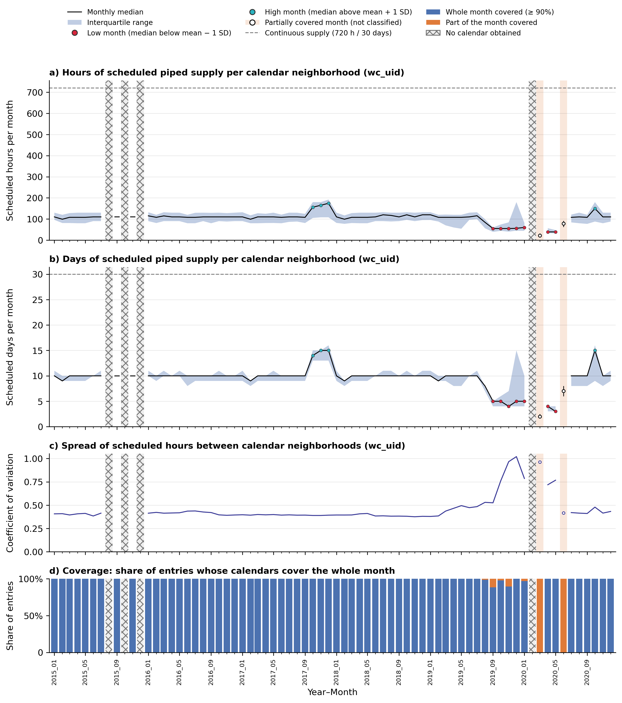

# SDG-6 Water Distribution Calendars – Processing Pipeline

[](https://doi.org/10.5281/zenodo.20000372)

Processing pipeline that converts the official Water Distribution Calendars of
Tegucigalpa, Honduras, into a standardized, neighborhood-level dataset of
**scheduled** piped water supply (days and hours per neighborhood and month).
The calendars record planned service; the pipeline does not measure delivery.

**Version 1.4** (pipeline `sdg6_calendar_pipeline` 1.4, BatchRunner 1.3) produced:

> Rivera, Y. A. (2026). *A Spatio-Temporal Dataset of Urban Water Distribution
> Schedules in Tegucigalpa (2015–2020)* (Version 1.0) [Data set]. Zenodo.
> https://doi.org/10.5281/zenodo.23771191

That dataset uses only the calendars delivered by the utility (SANAA, now UMAPS)
in response to information request SOL-SANAA-271-2021 (SIELHO). An earlier
dataset, *A Spatio-Temporal Dataset of Urban Water Distribution Schedules in
Tegucigalpa (2016–2025)* (https://doi.org/10.5281/zenodo.21499698), was produced
with earlier versions of this pipeline from calendars collected from several
public sources.



Monthly distribution of scheduled hours and days per calendar neighborhood,
2015–2020 (Figure 6 of the data descriptor).

## What this repository contains

Code, configuration and documentation only. It contains no calendars and no
data. The original calendars remain publications of the issuing institution and
can be requested through SIELHO (https://sielho.iaip.gob.hn); the processed data
are on Zenodo (above).

## Input

Calendars in **canonical form**: one spreadsheet per calendar, named
`YYYY_MM[a|b].xlsx` and stored as `calendar/<year>/<code>.xlsx`.

| Suffix | Period |
|---|---|
| none | full month |
| `a` | days 1–15 |
| `b` | day 16 to month end |

PDF calendars are first converted to spreadsheets (iLovePDF). Every calendar is
then prepared by hand (images, headers and auxiliary columns removed, merged
cells unmerged, sector/source/distributor columns added, group names harmonized
with the catalog) and each change is recorded in `manual_prep_log.csv`. Schedule
content is not altered.

## Pipeline

Each stage is run through `BatchRunner.py`, one process per call:

```bash
python scripts/BatchRunner.py --config config/pipeline_config.yaml \
       --input_base <calendar dir> --output_base data --process <process> [--year YYYY] [--file CODE]
```

| Order | Process | What it does |
|---|---|---|
| 1 | `parse_excel` | Reads the canonical calendars into a standard table |
| 2 | `clean_group` | Normalizes distribution-group text |
| 3 | `match_group_uid` | Assigns `group_uid` from the group catalog |
| 4 | `qa_missing_group_uid` | Reports groups without `group_uid` |
| 5 | `clean_neighborhood` | Splits and normalizes neighborhood names |
| 6 | `match_wc_uid` | Assigns `wc_uid` from the neighborhood catalog |
| 7 | `qa_catalog_wc_group` | Checks group ↔ calendar-unit consistency |
| 8 | `process_days` | Scheduled days per group and calendar |
| 9 | `hours` | Scheduled hours (windows crossing midnight handled) |
| 10 | `concat` | Merges all calendars into `all_hours.csv`; unparsable records go to `scheduled_errors.csv` |
| 11 | `qa_coverage` | Calendar periods and day coverage per month (read-only) |
| 12 | `aggregate_sdg11`, `aggregate_wc_group` | Monthly aggregates by `SDG11UID` and by `wc_uid` |
| 13 | `qa_nogis` | Calendar neighborhoods without a polygon |
| 14 | `figure6`, `maps` | Figures of the data descriptor |

Release and validation tools (each with its own config and provenance file):

| Tool | What it does |
|---|---|
| `release_fields/` | Adds `source_calendar`, `original_file`, `processing_date`, `pipeline_version` to the released tables |
| `release_gpkg/` | Builds one GeoPackage (polygons + all tables) and a GeoJSON of the polygons |
| `validate_trace/` | Traces identifiers through the pipeline stages and a stratified sample of records back to the original calendars |
| `compare_prepared/` | Compares the content of original and prepared calendar spreadsheets |

See `docs/` for the full execution guide.

## Identifiers

- `group_uid`: one calendar row (distribution group: sector, source, distributor).
- `wc_uid`: a neighborhood (or part of one) as named in the calendars.
- `SDG11UID`: neighborhood polygon identifier shared with other Tegucigalpa
  datasets. Calendar units without a polygon are marked `NOGIS`.

## Provenance

Every run logs the pipeline name and version and the configuration used
(`logs/`). The release tools write JSON provenance files with script versions and
the SHA-256 of their inputs and outputs. Every released record carries its
source calendar, original file, processing date and pipeline version.

## Requirements

Python 3, pandas, numpy, PyYAML, openpyxl, geopandas, pyogrio, matplotlib.

## Citation

If you use this code, cite the software record:

> Rivera, Y. A. (2026). *SDG-6 Water Distribution Pipeline (Tegucigalpa, 2015–2020)*
> (Version 1.4) [Software]. Zenodo. https://doi.org/[CODE DOI]

## License

Code: MIT License. Datasets on Zenodo: CC BY 4.0.
